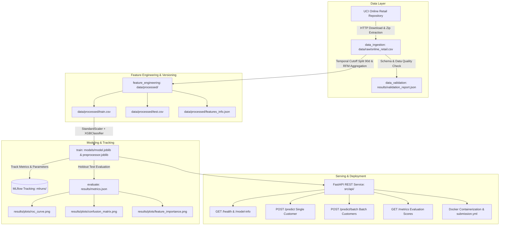

# 🛒 Reproducible Retail Churn ML Pipeline with DVC & FastAPI

[](https://www.python.org/)
[](https://fastapi.tiangolo.com/)
[](https://dvc.org/)
[](https://xgboost.readthedocs.io/)
[](https://mlflow.org/)
[](https://www.docker.com/)
[](https://pytest.org/)

---

## 📌 Executive Summary & Business Context
In non-contractual e-commerce platforms, customer churn does not occur through explicit cancellations or subscription terminations; customers simply cease purchasing. Identifying churn early enables marketing teams to deliver proactive win-back incentives and retain high-value accounts.

This repository provides an **end-to-end, production-grade Machine Learning pipeline** built on the **UCI Online Retail Dataset** (541,909 transactions across 4,372 customers). The project integrates:
1. **DVC (Data Version Control)** for declarative, reproducible stage orchestration and artifact tracking.
2. **Leak-Free RFM & Behavioral Feature Engineering** utilizing a 90-day temporal cutoff split.
3. **XGBoost Classifier** with **MLflow experiment tracking** and automated evaluation.
4. **FastAPI REST API** with robust Pydantic data validation, single/batch prediction endpoints, and automated retention recommendations.
5. **Containerization & Automated Evaluation** via Docker and standard `submission.yml`.

---

## 🏛️ System Architecture



---

## 🔍 Problem Formulation & Churn Definition

To prevent **lookahead data leakage**, we enforce a strict temporal cutoff:
- **Observation Cutoff ($T$)**: Set to **90 days** prior to the maximum transaction timestamp in the dataset (Cutoff: `2011-09-10`).
- **Feature Extraction Window ($t \le T$)**: Customer behavioral and RFM metrics are computed strictly using historical purchases occurring on or before $T$.
- **Target Observation Window ($t > T$)**:
  - **$\text{Churn} = 1$ (Churned)**: Customer made **0** purchases between $T$ and the dataset end date (`2011-12-09`).
  - **$\text{Churn} = 0$ (Retained)**: Customer made **$\ge 1$** purchase between $T$ and the dataset end date.

### Engineered Customer Features:
| Feature Name | Description | Business Rationale |
|---|---|---|
| `recency_days` | Days between cutoff $T$ and latest purchase | Strongest indicator of customer disengagement. |
| `frequency` | Total distinct purchase orders completed | Represents customer habit and purchase frequency. |
| `monetary_total` | Total net revenue spent before cutoff | Measures customer financial value (LTV proxy). |
| `avg_order_value` | Average spending per order (`monetary / frequency`) | Evaluates basket size and purchasing power. |
| `total_items_purchased` | Total units of goods bought | Captures volume behavior. |
| `unique_products` | Distinct product catalog items purchased | Measures catalog breadth and cross-category interest. |
| `cancellation_rate` | Ratio of cancelled invoices (`C` prefix) to total invoices | Signals customer friction or dissatisfaction. |
| `tenure_days` | Days from first order to cutoff $T$ | Captures customer loyalty duration and lifecycle stage. |
| `is_uk` | Binary flag (1 if United Kingdom, 0 otherwise) | Accounts for geographic concentration (domestic vs export). |

---

## 📊 Model Performance & Metrics

Evaluated on the holdout test set (853 samples, stratified split):

| Metric | Score |
|---|---|
| **ROC-AUC** | **0.7463** |
| **Recall (Churners)** | **70.27%** |
| **Accuracy** | **68.93%** |
| **F1-Score** | **0.6624** |
| **Precision** | **62.65%** |
| **PR-AUC** | **0.6319** |

### Confusion Matrix (Threshold = 0.5):
- **True Negatives (Retained correctly identified)**: 328
- **False Positives (Retained flagged as churn)**: 155
- **False Negatives (Missed churners)**: 110
- **True Positives (Churners correctly identified)**: 260

Artifacts generated automatically in `results/plots/`:
- `results/plots/roc_curve.png`: ROC curve illustrating discrimination threshold.
- `results/plots/confusion_matrix.png`: Heatmap breakdown of classification outcomes.
- `results/plots/feature_importance.png`: Feature importance ranks `recency_days`, `tenure_days`, and `cancellation_rate` as key churn drivers.

---

## ⚙️ DVC Pipeline Orchestration (`dvc.yaml`)

The ML pipeline is declared in `dvc.yaml` and parameterized in `params.yaml`:

```yaml
stages:
  ingest_data:
    cmd: python src/stages/ingest_data.py --config params.yaml
    deps: [src/stages/ingest_data.py, params.yaml]
    outs: [data/raw/online_retail.csv]

  validate_data:
    cmd: python src/stages/validate_data.py --config params.yaml
    deps: [src/stages/validate_data.py, data/raw/online_retail.csv, params.yaml]
    outs: [results/validation_report.json: {cache: false}]

  feature_engineering:
    cmd: python src/stages/feature_engineering.py --config params.yaml
    deps: [src/stages/feature_engineering.py, data/raw/online_retail.csv, params.yaml]
    params: [feature_engineering.cutoff_days_before_end, feature_engineering.test_size, base.random_state]
    outs: [data/processed/train.csv, data/processed/test.csv, data/processed/features_info.json: {cache: false}]

  train:
    cmd: python src/stages/train.py --config params.yaml
    deps: [src/stages/train.py, data/processed/train.csv, params.yaml]
    params: [train.xgboost_params.n_estimators, train.xgboost_params.max_depth, train.xgboost_params.learning_rate, train.xgboost_params.subsample, train.xgboost_params.colsample_bytree, train.xgboost_params.scale_pos_weight, train.xgboost_params.random_state]
    outs: [models/model.joblib, models/preprocessor.joblib]

  evaluate:
    cmd: python src/stages/evaluate.py --config params.yaml
    deps: [src/stages/evaluate.py, models/model.joblib, models/preprocessor.joblib, data/processed/test.csv, params.yaml]
    params: [evaluate.classification_threshold]
    metrics: [results/metrics.json: {cache: false}]
    plots:
      - results/plots/confusion_matrix.png: {cache: false}
      - results/plots/roc_curve.png: {cache: false}
      - results/plots/feature_importance.png: {cache: false}
```

### Reproducing Pipeline:
```bash
# Execute entire end-to-end pipeline
dvc repro

# View tracked metrics
dvc metrics show
```

---

## 🚀 FastAPI REST Service

### API Endpoints Overview
| HTTP Method | Endpoint | Description |
|---|---|---|
| `GET` | `/` | Service root and navigation links |
| `GET` | `/health` | Liveness and readiness probe |
| `GET` | `/model-info` | Model metadata, feature list, and evaluation metrics |
| `GET` | `/metrics` | Holdout evaluation metrics JSON |
| `POST` | `/predict` | Real-time single customer churn prediction |
| `POST` | `/predict/batch` | High-throughput batch inference endpoint |
| `GET` | `/docs` | Interactive Swagger UI documentation |

---

### API Usage Examples

#### 1. Single Customer Prediction (`POST /predict`)
**Request:**
```bash
curl -X POST "http://localhost:8000/predict" \
     -H "Content-Type: application/json" \
     -d '{
       "customer_id": 14520,
       "recency_days": 115.0,
       "frequency": 1,
       "monetary_total": 85.50,
       "avg_order_value": 85.50,
       "total_items_purchased": 12,
       "unique_products": 4,
       "cancellation_rate": 0.25,
       "tenure_days": 130.0,
       "is_uk": 1
     }'
```

**Response:**
```json
{
  "customer_id": 14520,
  "churn_prediction": 1,
  "churn_probability": 0.7814,
  "risk_level": "High",
  "recommendations": [
    "Immediate Win-Back Campaign: Offer a limited-time 20% discount on their top category.",
    "High Inactivity (115 days): Send personalized 'We Miss You' re-engagement email."
  ]
}
```

#### 2. Batch Prediction (`POST /predict/batch`)
**Request:**
```bash
curl -X POST "http://localhost:8000/predict/batch" \
     -H "Content-Type: application/json" \
     -d '{
       "customers": [
         {
           "customer_id": 1001,
           "recency_days": 12.0,
           "frequency": 8,
           "monetary_total": 1420.0,
           "avg_order_value": 177.50,
           "total_items_purchased": 220,
           "unique_products": 35,
           "cancellation_rate": 0.0,
           "tenure_days": 250.0,
           "is_uk": 1
         },
         {
           "customer_id": 1002,
           "recency_days": 140.0,
           "frequency": 1,
           "monetary_total": 35.0,
           "avg_order_value": 35.0,
           "total_items_purchased": 3,
           "unique_products": 1,
           "cancellation_rate": 0.5,
           "tenure_days": 150.0,
           "is_uk": 0
         }
       ]
     }'
```

**Response:**
```json
{
  "predictions": [
    {
      "customer_id": 1001,
      "churn_prediction": 0,
      "churn_probability": 0.1852,
      "risk_level": "Low",
      "recommendations": [
        "Healthy Customer: Maintain standard nurture sequence and early access to product launches.",
        "Upsell Opportunity: Invite customer to join the Tier 1 VIP Loyalty Rewards Program."
      ]
    },
    {
      "customer_id": 1002,
      "churn_prediction": 1,
      "churn_probability": 0.8129,
      "risk_level": "High",
      "recommendations": [
        "Immediate Win-Back Campaign: Offer a limited-time 20% discount on their top category.",
        "High Inactivity (140 days): Send personalized 'We Miss You' re-engagement email."
      ]
    }
  ],
  "total_evaluated": 2,
  "churn_count": 1,
  "churn_rate": 0.5
}
```

---

## 🧪 Testing Suite
The repository includes unit and integration tests covering feature extraction, edge cases, model serialization, and API endpoints:

```bash
# Run all tests with pytest
pytest -v
```

Output:
```
tests/test_api.py::test_root_endpoint PASSED
tests/test_api.py::test_health_endpoint PASSED
tests/test_api.py::test_model_info_endpoint PASSED
tests/test_api.py::test_metrics_endpoint PASSED
tests/test_api.py::test_predict_single_success PASSED
tests/test_api.py::test_predict_single_validation_error PASSED
tests/test_api.py::test_predict_batch_success PASSED
tests/test_features.py::test_calculate_customer_features_standard_customer PASSED
tests/test_features.py::test_calculate_customer_features_only_cancellations PASSED
tests/test_model.py::test_model_service_loading PASSED
tests/test_model.py::test_model_service_predict_single PASSED
tests/test_model.py::test_model_service_predict_batch PASSED

12 passed in 1.46s
```

---

## 🐳 Docker Deployment

Build and run the containerized FastAPI application:

```bash
# Build the Docker image
docker build -t retail-churn-api .

# Run the container
docker run -d -p 8000:8000 --name retail-churn-service retail-churn-api

# Check container health
curl http://localhost:8000/health
```

---

## 📋 Automated Evaluation (`submission.yml`)

As required by the submission guidelines, `submission.yml` provides standard commands for evaluation platforms:

```yaml
setup: pip install -r requirements.txt
dvc-pull: dvc pull
repro: dvc repro
run-service: uvicorn src.api.main:app --host 0.0.0.0 --port 8000
```

---

## 📁 Repository Directory Structure

```
retail-churn-dvc-fastapi/
├── .dvc/                             # DVC tracking metadata & remote configuration
├── .dvcignore                        # DVC ignore rules
├── .gitignore                        # Git exclusion rules
├── Dockerfile                        # Multi-stage container definition
├── .dockerignore                     # Docker build exclusions
├── submission.yml                    # Mandatory automated evaluation commands
├── params.yaml                       # Hyperparameters and pipeline configurations
├── dvc.yaml                          # Declarative DVC pipeline specification
├── dvc.lock                          # Deterministic DVC reproduction state
├── pytest.ini                        # Pytest runner settings
├── requirements.txt                  # Python dependencies
├── README.md                         # Comprehensive project documentation
├── data/
│   ├── raw/
│   │   ├── .gitignore                # DVC tracks online_retail.csv
│   │   └── online_retail.csv
│   └── processed/
│       ├── .gitignore                # DVC tracks train.csv & test.csv
│       ├── train.csv
│       ├── test.csv
│       └── features_info.json        # Feature distributions and summary stats
├── models/
│   ├── .gitignore                    # DVC tracks model artifacts
│   ├── model.joblib                  # Trained XGBoost model
│   └── preprocessor.joblib           # Fitted StandardScaler & feature schema
├── results/
│   ├── metrics.json                  # Test set evaluation metrics
│   ├── validation_report.json        # Raw data schema validation report
│   └── plots/
│       ├── confusion_matrix.png      # Confusion matrix visualization
│       ├── roc_curve.png             # ROC curve (AUC = 0.7463)
│       └── feature_importance.png    # Feature importance plot
├── src/
│   ├── __init__.py
│   ├── utils/
│   │   ├── __init__.py
│   │   ├── config.py                 # YAML configuration loader
│   │   └── logger.py                 # Logging utility
│   ├── stages/
│   │   ├── __init__.py
│   │   ├── ingest_data.py            # Automated UCI dataset ingestion
│   │   ├── validate_data.py          # Data quality & schema validator
│   │   ├── feature_engineering.py    # Temporal cutoff RFM feature extractor
│   │   ├── train.py                  # XGBoost training & MLflow tracker
│   │   └── evaluate.py               # Model evaluation & plot generator
│   └── api/
│       ├── __init__.py
│       ├── schemas.py                # Pydantic request/response models
│       ├── service.py                # Inference service & recommendations
│       └── main.py                   # FastAPI REST routing & lifespans
└── tests/
    ├── __init__.py
    ├── test_api.py                   # Integration tests for REST endpoints
    ├── test_features.py              # Unit tests for RFM feature logic
    └── test_model.py                 # Unit tests for model service
```

---

## 📜 License
This project is open-source and available under the [MIT License](LICENSE).