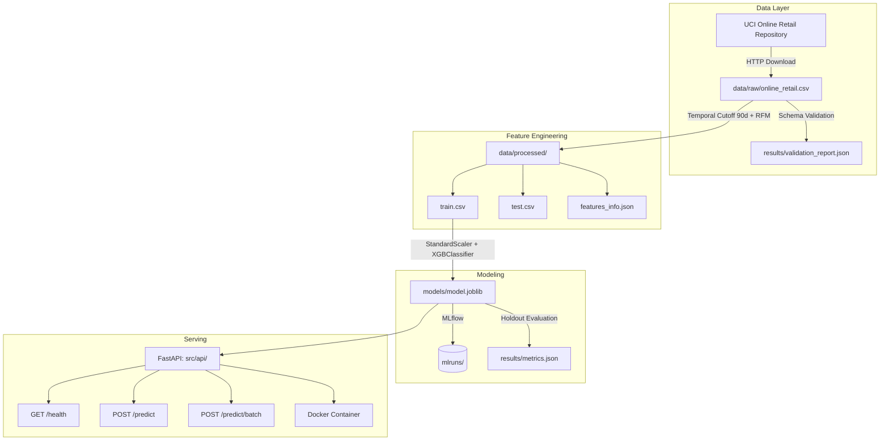

# Retail Churn ML Pipeline with DVC and FastAPI

An end-to-end, production-grade machine learning pipeline for retail customer churn prediction. Built on the UCI Online Retail Dataset (541,909 transactions, 4,372 customers). The entire pipeline is reproducible with a single `dvc repro` command.

---

## Architecture



---

## Problem Formulation

Churn is defined using a strict temporal cutoff to prevent data leakage:

- **Observation Cutoff (T)**: 90 days before the dataset end date (`2011-09-10`).
- **Features**: Computed from transactions on or before T.
- **Target**: Churn = 1 if the customer made zero purchases between T and `2011-12-09`; Churn = 0 otherwise.

### Engineered Features

| Feature | Description |
|---|---|
| `recency_days` | Days since last purchase before cutoff |
| `frequency` | Total distinct orders |
| `monetary_total` | Total net spend |
| `avg_order_value` | Average spend per order |
| `total_items_purchased` | Total units bought |
| `unique_products` | Distinct product SKUs purchased |
| `cancellation_rate` | Fraction of cancelled invoices |
| `tenure_days` | Days from first order to cutoff |
| `is_uk` | 1 if UK customer, 0 otherwise |

---

## Model Performance

Evaluated on a stratified holdout test set (853 samples):

| Metric | Score |
|---|---|
| ROC-AUC | 0.7463 |
| Recall (Churners) | 70.27% |
| Accuracy | 68.93% |
| F1-Score | 0.6624 |
| Precision | 62.65% |
| PR-AUC | 0.6319 |

---

## DVC Pipeline

Defined in `dvc.yaml`. Parameters are tracked in `params.yaml`.

```
Stages: ingest_data -> validate_data -> feature_engineering -> train -> evaluate
```

```bash
# Reproduce the full pipeline
dvc repro

# View tracked metrics
dvc metrics show
```

---

## FastAPI Service

| Method | Endpoint | Description |
|---|---|---|
| GET | `/` | Root and navigation |
| GET | `/health` | Liveness probe |
| GET | `/model-info` | Model metadata and feature list |
| GET | `/metrics` | Evaluation metrics |
| POST | `/predict` | Single customer prediction |
| POST | `/predict/batch` | Batch inference |
| GET | `/docs` | Swagger UI |

### Single Prediction Example

```bash
curl -X POST "http://localhost:8000/predict" \
     -H "Content-Type: application/json" \
     -d '{
       "customer_id": 14520,
       "recency_days": 115.0,
       "frequency": 1,
       "monetary_total": 85.50,
       "avg_order_value": 85.50,
       "total_items_purchased": 12,
       "unique_products": 4,
       "cancellation_rate": 0.25,
       "tenure_days": 130.0,
       "is_uk": 1
     }'
```

**Response:**
```json
{
  "customer_id": 14520,
  "churn_prediction": 1,
  "churn_probability": 0.7814,
  "risk_level": "High",
  "recommendations": [
    "Immediate Win-Back Campaign: Offer a limited-time 20% discount on their top category.",
    "High Inactivity (115 days): Send personalized re-engagement email."
  ]
}
```

---

## Setup and Quickstart

### Prerequisites

- Python 3.10+
- DVC
- Docker (optional)

### Local Setup

```bash
# 1. Install dependencies
pip install -r requirements.txt

# 2. Pull DVC-tracked artifacts (models and data)
dvc pull

# 3. Reproduce the full pipeline from scratch
dvc repro

# 4. Launch the API
uvicorn src.api.main:app --host 0.0.0.0 --port 8000
```

### Docker

```bash
# Build
docker build -t retail-churn-api .

# Run
docker run -d -p 8000:8000 retail-churn-api
```

---

## Testing

```bash
pytest -v
```

Tests cover: RFM feature logic, model service loading and inference, and all REST API endpoints (12 tests).

---

## Automated Evaluation (`submission.yml`)

```yaml
setup: pip install -r requirements.txt
dvc-pull: dvc pull
repro: dvc repro
run-service: uvicorn src.api.main:app --host 0.0.0.0 --port 8000
```

---

## Repository Structure

```
retail-churn-dvc-fastapi/
├── .dvc/                         # DVC metadata and remote config
├── .dvcignore
├── .gitignore
├── Dockerfile
├── .dockerignore
├── submission.yml                # Automated evaluation commands
├── params.yaml                   # Pipeline parameters and hyperparameters
├── dvc.yaml                      # Declarative pipeline definition
├── dvc.lock                      # Deterministic reproduction state
├── pytest.ini
├── requirements.txt
├── README.md
├── data/
│   ├── raw/online_retail.csv     # DVC-tracked raw dataset
│   └── processed/                # DVC-tracked processed splits
│       ├── train.csv
│       ├── test.csv
│       └── features_info.json
├── models/
│   ├── model.joblib              # Trained XGBoost model
│   └── preprocessor.joblib      # Fitted StandardScaler
├── results/
│   ├── metrics.json
│   ├── validation_report.json
│   └── plots/
│       ├── confusion_matrix.png
│       ├── roc_curve.png
│       └── feature_importance.png
├── src/
│   ├── utils/                    # Config loader and logger
│   ├── stages/                   # One script per DVC stage
│   │   ├── ingest_data.py
│   │   ├── validate_data.py
│   │   ├── feature_engineering.py
│   │   ├── train.py
│   │   └── evaluate.py
│   └── api/                      # FastAPI application
│       ├── main.py
│       ├── schemas.py
│       └── service.py
└── tests/
    ├── test_api.py
    ├── test_features.py
    └── test_model.py
```

---

